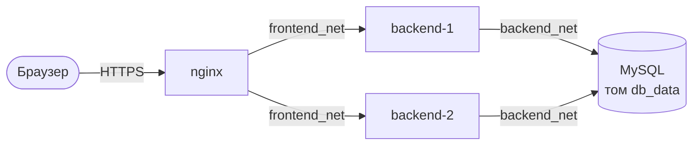

# Лаба 2. Всё в Docker

**Облачные технологии** · Лабораторная работа 2 

**Авторы:** _Дементьева Анна, Старикова Арина, Фролова Елизавета_

> Финальный шаг «Таро Штирлица»: Flask, MySQL и nginx из [Лабы 0](README_lab0.md) и [Лабы 1](README_lab1.md) теперь существуют в контейнерах и поднимаются одной командой.

## Оглавление

- [Что сделали](#-что-сделали)
- [Зачем](#-зачем)
- [Как запустить](#-как-запустить)
- [Плохой и хороший Dockerfile](#-плохой-и-хороший-dockerfile)
- [Сетевая изоляция](#-сетевая-изоляция)
- [Именованный том](#-именованный-том)
- [Проверки](#-проверки)
- [Скриншоты для отчёта](#-скриншоты-для-отчёта)

---

## Что сделали

Упаковали сервис в Docker-образы и подняли **весь стек одной командой** через `docker compose`.

В лабе четыре сервиса: `db`, `backend-1`, `backend-2` и `nginx`. Все общаются между собой.



## Зачем

Лаба про **воспроизводимость и безопасность**.

В Лабе 1 для запуска приходилось ставить Python, зависимости, запускать Flask руками, править `hosts` и генерировать сертификат. Теперь всё то же самое работает одной командой на любой машине с Docker, независимо от ОС, версии Python и установленных пакетов.

Вторая часть смысла в **best practices**. Разница между «работает у меня» и «готово к проду» — это зафиксированная версия базового образа, non-root пользователь, правильно уложенные слои, multi-stage сборка и healthcheck. Лаба нужна, чтобы эту разницу увидеть глазами и измерить.

## Как запустить

```bash
# 1. Прописать site-a.local и site-b.local в hosts
# 2. Сгенерировать сертификат и htpasswd (как в Лабе 1)
# 3. Собрать и поднять весь стек
docker compose up -d --build
```

Открываем https://site-a.local. Больше ничего запускать не нужно: Flask теперь тоже в контейнерах, а не в PyCharm.

Проверка: `docker ps` показывает **4 контейнера**, у бэкендов статус `Up (healthy)`.

---

## Плохой и хороший Dockerfile

Мы сделали два Dockerfile: один намеренно «плохой» (антипример), второй «хороший».

| Что сравниваем | Плохой | Хороший | Почему это важно |
|---|---|---|---|
| **Базовый образ** | `python:latest` (~1 ГБ) | `python:3.11-slim` (~130 МБ) | Меньше размер, быстрее скачивание и сборка. Фиксированная версия делает сборку воспроизводимой, а `latest` может измениться в любой момент |
| **Порядок слоёв** | `COPY . .` до установки зависимостей: кеш ломается при любой правке кода | Сначала `COPY requirements.txt`, потом `pip install`, потом `COPY . .` | Кеш работает, и пересборка после правки одной строки занимает секунды |
| **Пользователь** | `root` по умолчанию | `USER appuser` | Если приложение взломают, оно заперто в правах обычного пользователя |
| **HEALTHCHECK** | нет | есть | Docker сам проверяет, жив ли контейнер (`Up (healthy)`) |
| **Multi-stage build** | нет | есть | Сборочный этап отдельно от финального образа: в итог попадает только нужное |

**`.dockerignore`** не пускает в контекст сборки (и в сам образ) виртуальное окружение, `.git` и `.idea`. Сборка ускоряется, образ становится меньше.

## Сетевая изоляция

Мы сделали две сети:

| Сеть | Кто в ней |
|---|---|
| `frontend_net` | nginx и бэкенды |
| `backend_net` | бэкенды и база данных |

Бэкенд видит обе сети. Nginx в `backend_net` не входит, поэтому **физически не может достучаться до базы** и ничего о ней не знает.

Это принцип **наименьших привилегий**. Допустим, nginx взломают через уязвимость в обработке HTTP: до базы атакующий всё равно не доберётся, потому что nginx о ней даже не слышал.

## Именованный том

Данные MySQL лежат в именованном томе `db_data`. Они переживают и `docker compose down`, и пересоздание контейнера.

---

## Проверки

| Проверка | Команды | Ожидаемый результат |
|---|---|---|
| **Контейнеры живы** | `docker ps` | 4 контейнера, у бэкендов `Up (healthy)` |
| **Отказоустойчивость** | `docker stop lab0-backend-1-1` | Сайт продолжает работать через второй бэкенд |
| **Сохранность данных** | добавить карту → `docker compose down` → `docker compose up -d` → обновить страницу | Карта на месте |
| **Изоляция (nginx)** | `docker exec -it lab0-nginx-1 sh`, затем `getent hosts db` | **Пусто**: nginx не знает базу |
| **Изоляция (бэкенд)** | `docker exec -it lab0-backend-1-1 sh`, затем `getent hosts db` | `172.20.0.2`: бэкенд базу видит |

---

## 🏁 Итог

Весь стек (nginx, два бэкенда и MySQL) поднимается одной командой `docker compose up -d --build`. Образы собраны по best practices, nginx отрезан от базы на уровне сети, а данные переживают пересоздание контейнеров.

---
