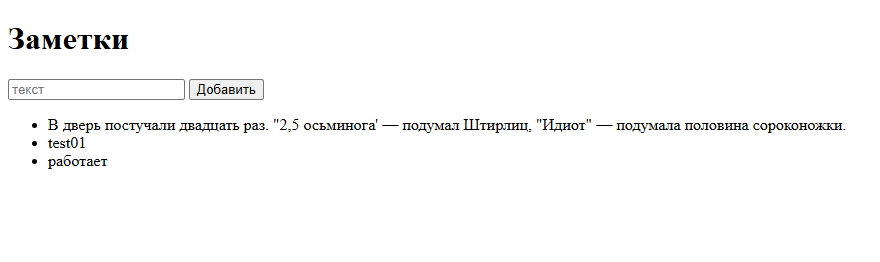

# Лабораторная 0

Мини-приложение, веб-страница с заметками, на странице форма добавления и список сохранённых
заметок. Сделано на Flask и MySQL. Flask отдаёт API и страницу, MySQL — отдельный контейнер.

Структура проекта:

* lab0
  * templates
    * index.html
  * docker_compose.yml 
  * app.py 
  * requirements.txt 
  * README.md 

### Что умеет мини-приложение:
- Добавить заметку через форму на странице.
- Показать все заметки из базы.
- Данные сохраняются в MySQL, следовательно переживают перезагрузку страницы и перезапуск
  Flask, пока жив контейнер базы.

## Запуск из терминала
1. `docker compose up -d`
2. `pip install -r requirements.txt`
3. `python app.py`
4. Открыть в браузере http://localhost:5000

## Проверка работоспособности 
Чтобы удостовериться, что вводимые данные идут в MySQL, а не в память Flask, пишем заметку и перезагружаем страницу. Если заметки сохраняются, всё работает.

Пример работы: 
После перезагрузки и перезапуска Flask список заметок не пропадает. 