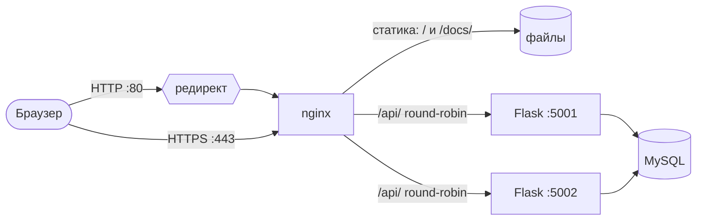

# Лаба 1. Nginx перед сервисом

**Облачные технологии** · Лабораторная работа 1

**Авторы:** _Дементьева Анна, Старикова Арина, Фролова Елизавета_

> Продолжаем «Таро Штирлица» из [Лабы 0](README_lab0.md): теперь перед Flask-бэкендом стоит nginx.

> **Про фронтенд.** «Таро Штирлица» появилось именно в этой лабе, но для бэкенда ничего не изменилось: он по-прежнему отдаёт `GET/POST /api/notes`, а новый фронт просто лёг поверх старого API без правок. Заметочный плейсхолдер был скучным, и теперь у фронта тоже есть свои кредиты в README.

---

## Что сделали

Поставили nginx как **точку входа** и **балансировщик** перед Flask из Лабы 0.



## Что умеет наш nginx

| Возможность | Как устроено | Как проверить |
|---|---|---|
| **HTTPS + редирект** | Самоподписанный сертификат (для локальной разработки достаточно), порт 80 принудительно ведёт на 443 | Открыть `http://site-a.local` и оказаться на `https://` |
| **Разделение фронта и бэка** | Nginx сам отдаёт статику (`/`, `/docs/`), а `/api/` проксирует во Flask | Статика грузится без участия Flask |
| **Балансировка** | Два экземпляра Flask (порты 5001 и 5002), запросы чередуются по кругу. Каждый отвечает со своим ID | Обновлять страницу: в ответах API чередуются `backend-5001` и `backend-5002` |
| **Отказоустойчивость** | Упавший бэкенд помечается как `down`, весь трафик уходит на живой | Погасить один Flask, сайт продолжает работать |
| **`alias`** | `/docs/` отдаётся из отдельной папки: URL и физический путь не совпадают | Открыть `/docs/` |
| **Виртуальные хосты** | Два домена (`site-a.local`, `site-b.local`) на одном nginx, у каждого своя папка и своя 404 | `https://site-b.local` открывает другой сайт |
| **Ограничение частоты** | `limit_req` на `/api/`: не больше 10 запросов в секунду с одного IP | Флуд возвращает **429** |
| **Кастомная 404** | Своя страница вместо стандартной белой | Открыть несуществующий путь |
| **Basic Auth** | `/admin` закрыт логином и паролем (`auth_basic` + `htpasswd`) | Без пароля **401**, с паролем страница открывается |

> **Деталь про виртуальные хосты.** Чужой домен не отдаёт ничего лишнего: `site-b.local/admin` возвращает 404, а не запрос пароля. Пароль настроен только на `site-a`.

## Зачем

Лаба про **архитектуру реального веба**. В продакшене пользователь почти никогда не ходит в приложение напрямую: между ними стоит nginx или похожий балансировщик. Он берёт на себя тяжёлое и повторяющееся (TLS, статику, лимиты, авторизацию), а приложение занимается только бизнес-логикой.

Главный смысл здесь **отказоустойчивость**: если половина бэкендов упала, сайт продолжает жить. Это уже про продакшен, а не про «у меня на ноуте работает».

## Как запустить

1. Прописать `site-a.local` и `site-b.local` в файл `hosts` (оба указывают на `127.0.0.1`).
   Windows: `C:\Windows\System32\drivers\etc\hosts`, Linux/macOS: `/etc/hosts`.
2. Сгенерировать самоподписанный сертификат для обоих доменов.
3. Сгенерировать `nginx/htpasswd` (логин `admin`, пароль `secret`).
4. Поднять nginx и MySQL:
   ```bash
   docker compose up -d
   ```
5. Запустить **два** процесса Flask:
   ```bash
   # Linux / macOS
   PORT=5001 python app.py
   PORT=5002 python app.py

   # Windows (PowerShell)
   $env:PORT=5001; python app.py
   $env:PORT=5002; python app.py
   ```
6. Открыть https://site-a.local и принять предупреждение о сертификате: он самоподписанный, так и должно быть.

## ✅ Как проверить

- Обновляем страницу: в ответах API чередуются `backend-5001` и `backend-5002`.
- Гасим один Flask: сайт продолжает работать.
- Открываем https://site-b.local: это другой сайт.

---
